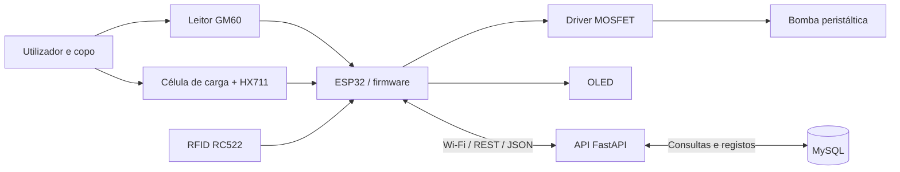

# SmartMix — Proposta Inicial do Projeto

**Licenciatura:** Engenharia Informática (ensino online)  
**Ano letivo:** 2026/2027 · 5.º semestre  
**Instituição:** IADE   
**Unidades curriculares:** Sistemas Distribuídos; Computação Física e IoT; Engenharia de Software  
**Autor:** Christian Joseph Marques  
**Modalidade:** Desenvolvimento individual  
**Repositório:** `https://github.com/ChristianCJM/SmartMix`
**Palavras-chave:** ESP32, IoT, sistemas distribuídos, automação, sensores, atuadores, REST API, MySQL, dosagem gravimétrica.

> **Estado do documento:** proposta inicial (Milestone 1). As funcionalidades e escolhas descritas como *previstas* ainda estão sujeitas a validação durante a prototipagem.

## 1. Resumo executivo

O **SmartMix** é uma proposta de sistema de preparação automatizada de bebidas, baseada num microcontrolador ESP32 e numa arquitetura distribuída. O utilizador coloca um copo numa plataforma, apresenta um código de barras ou QR code associado a uma receita e, após validação das condições necessárias, o dispositivo doseia os ingredientes através de bombas peristálticas.

A quantidade dispensada será controlada por **medição de massa** com uma célula de carga e um conversor HX711. A receita será obtida de um serviço Web através de uma API REST, com persistência em **MySQL**. O projeto prevê ainda um leitor RFID para autorização de receitas assinaladas como alcoólicas e um pequeno ecrã para indicação de estado.

A implementação será incremental: primeiro será validado um único canal de dosagem, seguindo-se a integração dos restantes canais, do backend e das funcionalidades complementares. O objetivo é demonstrar a integração de hardware, firmware, comunicação em rede, persistência de dados e testes de software num protótipo físico funcional.

## 2. Problema, motivação e oportunidade

A preparação manual de bebidas com múltiplos ingredientes exige a consulta de receitas, a medição de volumes e a execução sequencial de várias operações. Estas tarefas podem originar variações na composição final e são adequadas a um exercício de automação com sensores e atuadores.

O SmartMix pretende explorar uma alternativa de baixo custo, capaz de:

- identificar uma receita através de um código associado ao copo ou ao pedido;
- consultar remotamente a composição dessa receita;
- controlar a dosagem de forma automática e mensurável;
- apresentar o progresso e eventuais falhas;
- registar a execução para consulta e análise posterior.

A motivação principal é académica e técnica: construir um sistema completo que relacione **computação física** com **serviços distribuídos**, sem depender de equipamento industrial dispendioso.

## 3. Objetivos

### 3.1 Objetivo geral

Conceber, implementar e validar um protótipo de dispensador automático de bebidas, com identificação de receitas, dosagem controlada por peso e comunicação com um servidor REST e uma base de dados MySQL.

### 3.2 Objetivos específicos

1. Integrar um ESP32 com leitor de códigos, célula de carga/HX711 e comando de bomba peristáltica.
2. Identificar uma receita a partir do código lido e obter os respetivos ingredientes através da API.
3. Converter volumes definidos em mililitros em massas-alvo, utilizando densidades configuradas por ingrediente.
4. Controlar a bomba e interromper a dosagem ao atingir o valor-alvo, dentro de uma tolerância a determinar experimentalmente.
5. Implementar verificações de presença do copo, limites de dosagem e tratamento de erros.
6. Persistir receitas e registos de execução em MySQL.
7. Integrar, numa fase posterior, até três canais de dosagem e autorização RFID para receitas alcoólicas.
8. Documentar a arquitetura, os testes e as limitações do protótipo.

## 4. Público-alvo e contexto de utilização

O público-alvo principal é composto por estudantes, docentes e interessados em automação, IoT e prototipagem. O dispositivo é pensado para **demonstração em ambiente controlado**, não para utilização comercial ou serviço público de bebidas.

A experiência pretendida é simples: colocar um copo, identificar a receita, aguardar a preparação e receber uma indicação de conclusão ou erro. A escolha de ingredientes e quantidades será limitada à configuração e às capacidades físicas do protótipo.

## 5. Funcionalidades propostas e prioridades

| ID | Funcionalidade | Prioridade | Fase prevista |
|---|---|---|---|
| F01 | Inicialização e diagnóstico básico do ESP32 | Essencial | Protótipo inicial |
| F02 | Leitura de código de barras/QR via UART | Essencial | Protótipo inicial |
| F03 | Deteção de copo e leitura de massa via HX711 | Essencial | Protótipo inicial |
| F04 | Consulta de receita através de API REST | Essencial | Integração |
| F05 | Dosagem de um ingrediente por bomba peristáltica | Essencial | Milestone 2 |
| F06 | Interrupção por massa-alvo e por condições de segurança | Essencial | Milestone 2 |
| F07 | Registo de execução e resultado em MySQL | Essencial | Integração |
| F08 | Preparação sequencial com até três ingredientes | Desejável | Versão final |
| F09 | Autorização RFID para receitas alcoólicas | Desejável | Versão final |
| F10 | Indicação de estado em ecrã OLED | Desejável | Integração |

**Nota:** o RFID será utilizado apenas como mecanismo de autorização local com cartões previamente registados. **Não constitui verificação de idade ou identidade.**

## 6. Dois guiões preliminares de utilização e teste

### Guião A — Preparação bem-sucedida

**Pré-condições:** dispositivo alimentado; copo compatível colocado na plataforma; receita existente na base de dados; ingredientes disponíveis; sistema calibrado.

1. O utilizador coloca o copo na plataforma de pesagem.
2. O sistema deteta a presença do copo e verifica uma leitura estável.
3. O utilizador apresenta o código de barras ou QR code.
4. O ESP32 lê o identificador e solicita a receita ao servidor REST.
5. O servidor consulta a base de dados e devolve a composição da receita.
6. O ESP32 calcula a massa-alvo do ingrediente a partir do volume e da densidade configurada.
7. A bomba correspondente é acionada e a massa medida é acompanhada durante a dosagem.
8. Ao atingir a condição de paragem, a bomba é desligada.
9. O sistema apresenta a conclusão e comunica o resultado ao backend.

**Resultado esperado:** a receita é identificada, a dosagem termina sem ultrapassar os limites de segurança e a execução fica registada. A tolerância quantitativa será definida após ensaios de calibração.

### Guião B — Falha por ausência/remoção do copo

**Pré-condições:** dispositivo operacional; leitura de receita válida.

1. O utilizador apresenta o código sem colocar um copo, ou remove o copo durante a preparação.
2. O sistema identifica uma condição inválida através da medição de massa e das verificações de estado.
3. O ESP32 impede o arranque da bomba ou interrompe imediatamente o comando de dosagem.
4. É apresentada uma mensagem de erro.
5. O evento é registado quando existir ligação ao servidor.
6. A execução apenas poderá recomeçar após restabelecimento das condições e nova ação do utilizador.

**Resultado esperado:** não ocorre dosagem intencional sem recipiente; a falha é visível e o atuador permanece desligado.

### Testes adicionais a preparar

- Código inexistente ou receita inválida.
- Falha de Wi-Fi/API durante a consulta ou registo.
- Leitura instável ou perda de comunicação com HX711.
- Tempo máximo de acionamento da bomba excedido.
- Receita alcoólica sem cartão RFID autorizado.

## 7. Hardware e materiais

| Componente | Função | Estado inicial |
|---|---|---|
| ESP32 (kit ELEGOO) | Controlo, Wi-Fi e comunicação com periféricos | Disponível; programação e comunicação série testadas |
| Leitor GM60 UART | Leitura de códigos 1D/2D | Disponível; ligação física pendente de adaptador compatível |
| Célula de carga + HX711 | Medição de massa e presença do copo | Disponíveis; ligação e montagem por concluir |
| Bomba peristáltica | Dosagem de líquidos | Uma unidade disponível; ensaio pendente |
| Driver MOSFET | Comutação elétrica da bomba | Disponível; compatibilidade elétrica por verificar |
| Módulo RC522 RFID | Autorização de receitas restritas | Disponível no kit; integração posterior |
| Ecrã OLED | Mensagens de estado | Disponível no kit; integração posterior |
| Breadboard e jumpers | Montagem experimental | Disponíveis no kit |
| Fonte de alimentação da bomba | Alimentação independente do atuador | A especificar após confirmação da tensão/corrente da bomba |
| Reservatórios, tubagem e estrutura | Circuito de líquido e suporte físico | Parcialmente disponíveis; montagem por definir |
| Duas bombas adicionais | Expansão para três ingredientes | Planeadas, não adquiridas nesta fase |

**Precauções:** não alimentar a bomba diretamente a partir do ESP32; verificar tensão, corrente, massa comum, comando do MOSFET e proteção contra transientes antes de energizar o circuito. Para testes com líquidos destinados a consumo, utilizar materiais adequados ao contacto alimentar e um procedimento de higienização; os primeiros ensaios podem utilizar água.

## 8. Software e tecnologias

| Camada | Tecnologia proposta | Responsabilidade |
|---|---|---|
| Firmware | C++ / Arduino, PlatformIO, VS Code | Sensores, atuadores, estados do processo e comunicação |
| Rede | Wi-Fi, HTTP/HTTPS e JSON | Comunicação entre ESP32 e API |
| Backend | Python / FastAPI | Disponibilização de receitas, validação e registos |
| Persistência | MySQL | Receitas, ingredientes, densidades, autorizações e histórico |
| Documentação | Markdown, GitHub, diagramas | Versionamento, entregáveis e rastreabilidade |
| Testes | Testes de API, ensaios físicos e guiões | Verificação funcional e tratamento de falhas |

A linguagem e as bibliotecas concretas poderão ser ajustadas durante a implementação, desde que se mantenham os objetivos e os requisitos das unidades curriculares.

## 9. Arquitetura distribuída proposta



### Responsabilidades e fluxo de dados

1. **Aquisição:** o ESP32 recebe o identificador do código e as medições de massa.
2. **Consulta:** o ESP32 envia o identificador ao backend e recebe os ingredientes, volumes e parâmetros necessários.
3. **Controlo local:** o ESP32 decide quando ativar/desativar cada bomba. A lógica de paragem deve continuar a funcionar independentemente da disponibilidade da rede.
4. **Persistência:** o backend grava receitas e eventos de preparação na base de dados.
5. **Apresentação:** o dispositivo informa o utilizador do estado atual e de eventuais falhas.

### Exemplos preliminares de endpoints

| Método | Endpoint | Finalidade |
|---|---|---|
| `GET` | `/api/recipes/{code}` | Obter receita a partir do código lido |
| `POST` | `/api/preparations` | Criar registo de preparação |
| `PATCH` | `/api/preparations/{id}` | Atualizar estado, medições e resultado |
| `GET` | `/api/health` | Verificar disponibilidade do serviço |

Estes endpoints são **propostas de interface**, não serviços já implementados.

### Modelo de dados preliminar

- **Ingredient:** identificador, nome, densidade (g/mL), canal de bomba associado.
- **Recipe:** identificador, código de leitura, nome, indicação de autorização necessária.
- **RecipeIngredient:** receita, ingrediente, volume-alvo (mL) e ordem de execução.
- **Preparation:** receita, instante, estado, massa medida, resultado e eventual erro.
- **AuthorizedTag:** identificador RFID autorizado *(opcional, se esta funcionalidade for implementada)*.

A conversão proposta é: **massa-alvo (g) = volume (mL) × densidade (g/mL)**. A exatidão dependerá da calibração, da resolução do sensor, do comportamento da bomba e do líquido utilizado.

## 10. Esboço do artefacto físico

O protótipo será organizado em três zonas funcionais:

```text
   [Reservatório A]  [Reservatório B]  [Reservatório C]
          |                |                |
       [Bomba A]        [Bomba B]        [Bomba C]
          \                |                /
           \_______ Tubos de saída _______/
                         |
                   [Zona de doseamento]
                         v
                      [Copo]
               [Plataforma de pesagem]
                  [Célula de carga]

  [Leitor GM60]  [Leitor RFID]  [OLED]
              \       |       /
                    [ESP32]
                       |
                [Wi-Fi / API / BD]
```

O desenho representa a **configuração final pretendida**. Na primeira fase, será montada apenas uma linha de bomba, com um reservatório e a plataforma de pesagem. A estrutura poderá utilizar componentes e materiais comerciais, sem necessidade de impressão 3D.

## 11. Plano de trabalho e calendarização

| Período / marco | Atividades previstas | Resultado esperado |
|---|---|---|
| Até 27/10/2026 — Milestone 1 | Ideação, escolha de componentes, proposta, arquitetura e documentação | Proposta inicial e apresentação |
| Final de outubro–início de novembro | Montagem do leitor, HX711, testes UART, calibração e circuito de bomba | Sensores e atuador validados separadamente |
| Até 13–14/11/2026 | Especificação de requisitos e descrição das funcionalidades IoT | Documentação das UCs correspondentes |
| Até 30/11/2026 — Milestone 2 | Integração de pelo menos um sensor, um atuador e lógica de controlo | Protótipo funcional de um canal |
| Dezembro de 2026 | API REST, MySQL, consulta de receitas, registos e expansão de canais | Fluxo distribuído integrado |
| Janeiro de 2027 | RFID/OLED se viáveis, ensaios, testes de falha, correções e documentação | Versão estabilizada e validada |
| 01/02/2027 — Entrega final prevista | Demonstração, relatório, vídeo e apresentação | Entrega final do projeto |

**Distribuição de tarefas:** projeto individual. O autor assume a análise, aquisição e montagem de hardware, desenvolvimento do firmware, backend, base de dados, integração, testes, documentação e apresentação.

### Estratégia de desenvolvimento incremental

- **Iteração 1:** ESP32 e comunicação série; ligação e leitura do scanner.
- **Iteração 2:** célula de carga, calibração e deteção do copo.
- **Iteração 3:** comando seguro de uma bomba e dosagem com feedback de massa.
- **Iteração 4:** integração REST/MySQL e leitura de receitas remotas.
- **Iteração 5:** expansão para três canais, RFID, OLED e robustez.

## 12. Riscos, dependências e medidas de mitigação

| Risco | Impacto | Mitigação proposta |
|---|---|---|
| Incompatibilidade de conectores ou alimentação | Atraso na montagem ou danos | Verificar pinout, tensão e corrente antes da ligação |
| Leituras de massa instáveis | Dosagem imprecisa | Calibração, filtragem e ensaios com água |
| Inércia/fluxo residual da bomba | Excesso de líquido | Medir erro e ajustar antecipação da paragem |
| Falha da rede ou do servidor | Receita indisponível | Impedir arranque sem dados válidos; controlo local de segurança |
| Fugas ou contacto de líquidos com eletrónica | Danos e risco elétrico | Separação física, fixação de tubos e testes supervisionados |
| Tempo limitado de desenvolvimento individual | Funcionalidades incompletas | Priorizar um canal funcional antes da expansão |
| Falhas de autorização RFID | Preparação indevida de receita restrita | Estado por defeito não autorizado; validação explícita |

## 13. Critérios preliminares de sucesso

Considera-se que o protótipo mínimo cumpre os objetivos principais quando:

1. O ESP32 lê um identificador válido de código de barras/QR.
2. O sistema obtém uma receita a partir de um serviço REST ligado a MySQL.
3. O dispositivo deteta o copo e mede a variação de massa.
4. Uma bomba doseia líquido e desliga automaticamente ao atingir a condição-alvo.
5. As falhas essenciais (ausência de copo, erro de leitura, timeout) colocam o atuador num estado seguro.
6. O backend regista o resultado da operação.
7. A solução é documentada e demonstrável.

A precisão da dosagem será quantificada em testes; **não se assume nesta fase uma tolerância numérica sem dados experimentais**. A implementação de três canais, OLED e RFID será avaliada em função do progresso e do tempo disponível.

## 14. Estado atual do projeto

À data desta proposta:

- O projeto **SmartMix** foi criado em VS Code/PlatformIO.
- O ESP32 foi programado com sucesso e a comunicação série foi testada.
- Foram adquiridos os principais componentes de um canal de dosagem, incluindo scanner GM60, célula de carga/HX711, bomba peristáltica e drivers MOSFET.
- Foi criado o repositório GitHub e definida uma estrutura inicial de pastas.
- A integração física, a API, a base de dados e a dosagem automática **ainda não estão implementadas**.

## 15. Enquadramento nas unidades curriculares

**Sistemas Distribuídos:** desenho da arquitetura ESP32–API–MySQL, comunicação em rede, gestão do projeto e integração de serviços.

**Computação Física e IoT:** programação do ESP32, aquisição de sinais do scanner e da célula de carga, comando de bombas e interação com o utilizador.

**Engenharia de Software:** requisitos funcionais e não funcionais, cenários de utilização, estratégia de testes, tratamento de falhas e documentação.

**Inteligência Artificial:** o briefing geral inclui esta UC, mas **não está prevista uma componente de IA no âmbito individual deste trabalho**, de acordo com o enquadramento académico comunicado pelo autor. Esta exceção deve estar confirmada junto dos docentes responsáveis.

## 16. Conclusão

O SmartMix constitui um caso prático de integração entre um dispositivo físico e uma infraestrutura distribuída. A proposta combina identificação de receitas, medição gravimétrica, atuação controlada, comunicação REST e persistência em MySQL. A abordagem incremental reduz o risco de desenvolvimento e permite apresentar primeiro um protótipo funcional de um canal, mantendo como objetivo de evolução um sistema de até três ingredientes.

---